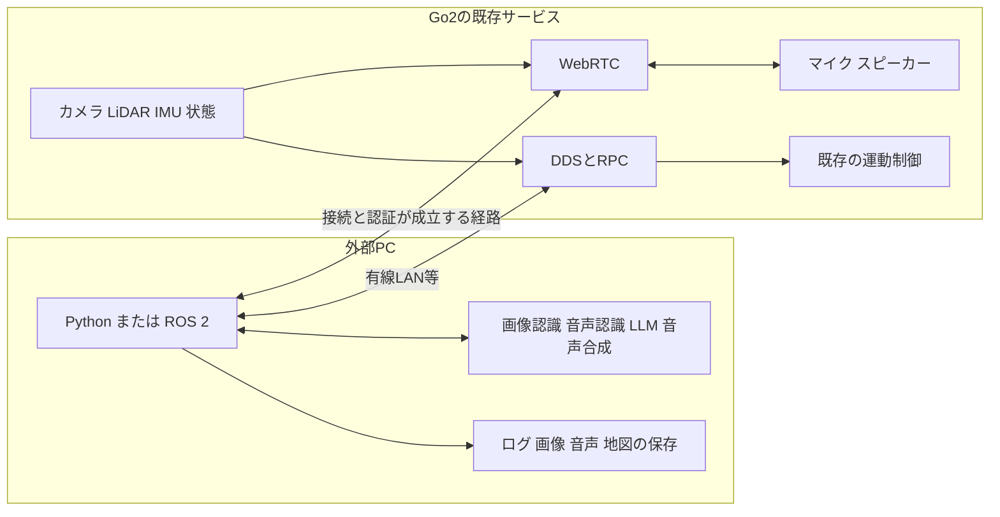

# Go2の内部PCを変更せずに外部プログラムから利用できる機能

調査日：2026年11月11日。対象：このワークスペースに接続中のGo2と、外部PCで動かすPythonおよびROS 2。

**内部PCへのソフトウェア追加やファームウェア変更なしで、外部PCからカメラ・LiDAR・各種状態情報を取得できることを、この実機で確認した。** 本体マイクの受信とスピーカーへの音声送信にはWebRTCの公開実装があり、外部PCで日本語の音声認識・会話・音声合成を実行する構成が可能である。ただし、この実機のマイク音声受信・スピーカー再生は未検証であり、機種の音声ハードウェアとWebRTCの認証条件を確認する必要がある。

音声管理については、コミュニティ実装で定義されたAudioHubの取得APIをDDS経由でも呼び出せた。したがって「音声関連機能はすべてWebRTCが必須」とは言えない。一方、音声ファイル一覧が取得できることは、録音や発話が成功する証明にはならない。

## 調査条件と判定の意味

「内部PCを変更しない」は、Go2側へのインストール、SSH経由の配置、OS設定変更、既存サービスの置き換え、ファームウェア更新を行わず、出荷済みの通信サービスを外部から利用することとした。今回実行したのは状態の購読と取得APIだけであり、移動・姿勢変更・音声再生・録音・音量変更・サービス切替は行っていない。カメラ画像はメモリ上で復号し、画像ファイルを保存していない。LiDARも点群データ本体をファイル保存していない。

本体への**データ書き込みも避けたい場合**は、音声ファイルのアップロードや本体への地図保存も除外する。スピーカーにはWebRTCで音声を送り、音声・画像・地図の保存とAI処理を外部PCで行う構成を選ぶ。APIによる音量やモード変更は実行時の状態を変えるため、ソフトウェアを変更しないこととは区別する。

| 判定 | 意味 |
|---|---|
| 実機確認 | 今回、接続中のGo2から応答またはデータを取得した |
| 条件付き | 公式APIまたは開発元の公開実装に経路があるが、当該機能の実動作はこの実機で確認していない |
| 未確定 | 必要なハードウェア、公開APIの仕様、または実機での有効性が確定していない |
| 対象外 | 内部PCのソフトウェア変更が必要な構成など、今回の条件に含めないもの |

APIの戻り値0は、その取得要求の成功を表す。運動状態の`error_code`、サービス一覧の`status`、センサーの異常コードは別の値であり、混同しない。

## 機能別の利用可否

表の「条件付き」は、すぐにこの実機で使えるという保証ではない。接続先のAIR・PRO・X・EDUの区分と本体ファームウェア版は、今回の取得情報からは特定していない。

| 機能 | 判定 | 外部PCからの利用方法 | この実機での結果または条件 |
|---|---|---|---|
| 前方カメラの画像取得 | **実機確認** | 公式SDK `VideoClient.GetImageSample()` | 1920×1080、3チャンネルに復号成功 |
| カメラの連続表示・録画 | 条件付き | 画像取得の繰り返し、またはWebRTC映像受信 | 連続表示の公式サンプルあり。連続時のFPS・遅延・録画は未測定 [公式カメラ例](https://github.com/unitreerobotics/unitree_sdk2_python/blob/master/example/go2/front_camera/camera_opencv.py) |
| 画像認識・人物検出・OCR | 条件付き | 取得画像を外部PC上の認識モデルへ入力 | 画像入力は取得済み。認識処理は外部側で追加する |
| 内蔵マイクからの環境音・発話受信 | 条件付き | WebRTCの受信音声トラック | 音声搭載機で実装あり。この実機での可聴音声受信は未検証 [録音実装](https://github.com/legion1581/unitree_webrtc_connect/blob/master/examples/go2/audio/save_audio/save_audio_to_file.py) |
| マイクのDDS直接受信 | 未確定 | `rt/audiosender`、`AudioData_` | 公開エンドポイントを検出。トピック名や型だけでは有効な音声と判定できない。詳細は音声の節 |
| スピーカーで任意の音を再生 | 条件付き | 外部PCからWebRTC音声トラックを送る | MP3送信実装あり。音量取得値は0で、実際の再生は未検証 [再生実装](https://github.com/legion1581/unitree_webrtc_connect/blob/master/examples/go2/audio/mp3_player/play_mp3.py) |
| 音声ファイル一覧・再生モード取得 | **実機確認** | DDS `audiohub` の取得API | 一覧は空、再生モードは`no_cycle` |
| 音声ファイルのアップロード・選択再生 | 条件付き | AudioHubのファイルAPI | 実装あり。本体にファイルを書き込むため、データ書き込みも禁止する場合は除外 [AudioHub実装](https://github.com/legion1581/unitree_webrtc_connect/blob/master/unitree_webrtc_connect/webrtc_audiohub.py) |
| 日本語の任意テキストを発話 | 条件付き | 外部PCでTTSを実行し、生成音声を本体に送信 | 内蔵日本語TTSへの依存を避けられる。音声送信と発音の確認が必要 |
| 日本語の音声認識・音声コマンド | 条件付き | 本体音声またはPCマイク → 外部PCのWhisper等 → 動作API | 現在の`go2_voice.py`はPCマイクを使用。本体マイクへの対応は未実装 |
| 会話AI・映像を見て話すシステム | 条件付き | マイク・画像 → 外部PCのASR・LLM・TTS → スピーカー | 各入出力を接続して構築する。標準機能だけで任意の日本語会話が完成するという意味ではない |
| 音量・照明の現在値取得 | **実機確認** | 公式 `VuiClient` | 音量0、輝度0、スイッチ値1 |
| 音量・照明の変更 | 条件付き | `SetVolume`、`SetBrightness`等 | 公式APIあり。値の範囲・保存挙動は使用時に確認 [VUI実装](https://github.com/unitreerobotics/unitree_sdk2_python/blob/master/unitree_sdk2py/go2/vui/vui_client.py) |
| 位置・速度・姿勢・運動状態 | **実機確認** | `rt/sportmodestate`等 | 状態受信成功。ただし`error_code=1001` |
| IMU・関節状態・電池残量 | **実機確認** | `rt/lowstate`、`rt/lf/lowstate` | IMU・関節状態配列・残量97%等を取得 |
| 足先荷重に関する値 | **実機確認** | `LowState_.foot_force`等 | 数値は受信。実センサー搭載・校正・物理単位の正しさまでは確認していない |
| 前後左右の移動・旋回・起立・伏せ | 条件付き | 公式 `SportClient`、またはWebRTCの運動RPC | 運動APIの版取得は成功。実際の動作指令は送っていない [Sport実装](https://github.com/unitreerobotics/unitree_sdk2_python/blob/master/unitree_sdk2py/go2/sport/sport_client.py) |
| お手・ストレッチ・ダンス等 | 条件付き | `Hello`、`Stretch`、`Dance1/2`等 | APIの存在と、各機体・モードでの実行可否は別。動作試験なし [Sport実装](https://github.com/unitreerobotics/unitree_sdk2_python/blob/master/unitree_sdk2py/go2/sport/sport_client.py) |
| 関節の低レベル制御・独自歩容 | 条件付き | DDS `rt/lowcmd`等 | 公式の低レベル経路。高レベル制御との競合解消と対応機種が前提。今回未実施 [公式SDK](https://github.com/unitreerobotics/unitree_sdk2_python) |
| LiDARの点群取得 | **実機確認** | DDS `rt/utlidar/cloud`、`PointCloud2_` | 約15.4Hz、最終サンプル3882点 |
| LiDARのWebRTC受信 | 条件付き | 圧縮点群を受信し外部PCで復号 | 公開実装あり。DDSの点群経路とは別 [LiDAR実装](https://github.com/legion1581/unitree_webrtc_connect/blob/master/examples/go2/data_channel/lidar/lidar_stream.py) |
| 障害物回避の有効状態取得 | **実機確認** | `ObstaclesAvoidClient.SwitchGet()` | `true`。実際の回避性能は未試験 |
| 障害物回避を使った走行 | 条件付き | 専用の回避サービスへ速度指令 | 状態が有効なだけでは、通常の`SportClient.Move()`にも同じ回避処理がかかるとは断定できない [回避API実装](https://github.com/unitreerobotics/unitree_sdk2_python/blob/master/unitree_sdk2py/go2/obstacles_avoid/obstacles_avoid_client.py) |
| 地図作成・自己位置推定・自律移動 | 条件付き | 外部PC上のROS 2・SLAM・Nav2とGo2入出力を接続 | 点群入力は確認済み。地図、座標変換、オドメトリ、走行制御の統合が必要 [ROS 2統合実装](https://github.com/abizovnuralem/go2_ros2_sdk) |
| リモコン状態・UWB距離方向の取得 | 未確定 | `rt/wirelesscontroller`、`rt/uwbstate` | エンドポイントを検出したが、今回の約11秒の観測では対象サンプルなし |
| UWB追従・外部PCによる人物追従 | 条件付き | 対応UWB機器、または画像認識と速度指令の組合せ | 対応機器・新鮮な測距値・追従ロジックが必要。現時点では実動作未確認 |
| 深度カメラ・追加センサー | 未確定 | 外部PCへ直接接続できる機器なら個別ドライバで利用 | 前方RGB画像が取れることは深度画像取得の証明にならない。実機の追加構成を確認する |
| 遠隔監視・インターネット越しの接続 | 条件付き | WebRTC Remote、Unitreeクラウド経由 | アカウント、登録機体、クラウド到達性等に依存。今回はローカルDDSのみ [接続実装](https://github.com/legion1581/unitree_webrtc_connect/blob/master/unitree_webrtc_connect/webrtc_driver.py) |
| 内蔵AI・GPTの自由な呼び出し | 未確定 | GPT関連トピックは可視 | トピックの存在だけでは、外部向けAPI仕様・対応言語・利用権限を確定できない |
| 内部Linuxへの任意プログラム配置 | 対象外 | SSH・内部PCへのインストール等 | 今回の条件では使わない |

## 接続中の実機で確認した結果

最終測定時刻は2026年11月11日15時26分14秒〜25秒 JST。詳細は[測定結果JSON](research/go2_readonly_probe_2026-11-11.json)に保存した。状態・音量などはこの時点のスナップショットであり、現在値を固定するものではない。

### 接続と応答

| 項目 | 結果 |
|---|---|
| 外部PCのGo2接続インターフェース | `enx9c69d351a4cf` |
| 外部PCの有線IPv4 | `192.168.123.222/24` |
| DDSドメイン | 0 |
| 運動APIのサーバー版 | `1.0.0.1`、応答コード0 |
| RobotState APIのサーバー版 | `1.0.0.2`、応答コード0 |
| 障害物回避APIのサーバー版 | `1.0.0.2`、応答コード0 |
| VideoHub APIのサーバー版 | `1.0.0.0`、応答コード0 |
| VUIのサーバー版取得 | コード3104、3秒でタイムアウト |
| VUIの個別取得API | スイッチ・音量・輝度の取得はすべてコード0 |
| 前方カメラ | 191724バイト受信、`[1080, 1920, 3]`に復号成功 |
| AudioHubの音声一覧 | コード0、`{"audio_list": []}` |
| AudioHubの再生モード | コード0、`{"play_mode": "no_cycle"}` |

ここにあるAPIの版は**本体ファームウェア版ではない**。例えば運動APIの`1.0.0.1`から、WebRTCの認証方式を判断できない。`LowState_`の版フィールドも今回`[0, 0]`で、製品ファームウェア版の特定には使っていない。

VUIの版取得だけがタイムアウトした一方で、個別の取得は成功した。単一APIの失敗からサービス全体を利用不能と判断しない。コード3104の定義は、同梱SDKの[rpc/internal.py](../vendor/unitree_sdk2_python/unitree_sdk2py/rpc/internal.py)にある`RPC_ERR_CLIENT_API_TIMEOUT`。

### データ受信

| トピック | 受信数 | 観測上の概算頻度 | 主な内容 |
|---|---:|---:|---|
| `rt/sportmodestate` | 3218 | 298.2Hz | 位置、速度、モード、エラーコード |
| `rt/lf/sportmodestate` | 216 | 20.0Hz | 低頻度の運動状態 |
| `rt/lowstate` | 5363 | 497.4Hz | IMU、関節状態、バッテリー等 |
| `rt/lf/lowstate` | 215 | 20.0Hz | 低頻度の低レベル状態 |
| `rt/utlidar/cloud` | 167 | 15.4Hz | 3D点群 |
| `rt/utlidar/voxel_map` | 0 | 算出不可 | この観測条件では受信なし |
| `rt/utlidar/lidar_state` | 0 | 算出不可 | この観測条件では受信なし |
| `rt/wirelesscontroller` | 0 | 算出不可 | この観測条件では受信なし |
| `rt/uwbstate` | 0 | 算出不可 | この観測条件では受信なし |

頻度は最初と最後の受信時刻から求めた短時間の観測値であり、仕様上の保証値ではない。0件は、この機能やハードウェアが存在しないという意味ではない。

最終LiDARサンプルは`width=3882`、`height=1`、`frame_id=utlidar_lidar`、`point_step=32`、データ長124224バイト。フィールドは`x, y, z, intensity, ring, time`。XYZだけでなく、強度等の情報を含む点群を外部PCで処理できる。

低レベル状態では電池残量97%、電圧約32.0V、IMU姿勢、関節状態の20要素分の配列、リモコン情報用の40バイト領域を取得した。20要素の配列は実機が20関節という意味ではない。`foot_force=[17,24,17,14]`、`foot_force_est=[0,0,0,0]`も受信したが、センサー搭載区分や値の物理的な妥当性は別途確認が必要である。

### 運動状態とサービス一覧

運動状態は`mode=0`、`error_code=1001`だった。**このエラーコードの意味は今回確定しておらず、正常と判定していない。** SDKの通信が成功していても、実際に走行可能な状態とは限らない。

既存の[go2_voice.py](../go2_voice.py)は、通常は状態コード0のみを許可し、明示指定による例外も100だけである。今回の1001では既存の安全条件を満たさない。音声操作を追加する際も、1001を正常値として許可する変更は行わず、本体・公式アプリの状態を先に確認する。

`ServiceList()`は31件を返した。関連する名前には`audio_hub`、`audio_player_service`、`video_hub`、`go2_videohub_rtsp_server`、`unitree_lidar`、`unitree_lidar_slam`、`webrtc_bridge`、`webrtc_signal_server`、`chat_go`、`gesture_recognition`等が含まれる。名称はサービスの存在を示す手掛かりであり、それだけで各機能の利用成功とは判定しない。`status`の数値はJSONに原文のまま保存し、起動・停止の意味を推測して書き換えていない。

DDSの探索結果には、調査プログラム自身が作成した要求送信用・応答受信用のエンドポイントも含まれる。探索一覧は、すべてがロボット側で生成されたことや、すべてが有効なデータを流していることの証明ではない。

## 外部PCとGo2の役割分担



外部PCに判断・認識・会話処理を置き、Go2には既存のセンサー配信・音声入出力・運動制御を担当させる。DDSとWebRTCは別の接続経路なので、DDS接続の成功からWebRTCの接続成功を推定しない。

公式の[unitree_ros2](https://github.com/unitreerobotics/unitree_ros2)は、UnitreeのDDS通信とROS 2を接続する経路を説明している。ROS 2を使うためにGo2内部へROS 2を新規インストールする必要はない。型定義、DDS実装、ネットワークインターフェース等を外部PC側で揃える。

## カメラと映像処理

現在の接続では、同梱の公式SDKにある[VideoClient](../vendor/unitree_sdk2_python/unitree_sdk2py/go2/video/video_client.py)で画像を取得できる。初期化、取得、バイナリの復号は外部PCで完結する。今回復号できたことを確認しており、画像内容の目視評価や画質評価は行っていない。

連続取得してOpenCVで表示・録画し、その画像を人物検出や物体認識に渡す構成が取れる。1回の取得所要時間から動画の安定FPSを決めない。動画としての遅延やネットワーク負荷を測る場合は、連続受信と時刻の測定が必要になる。[公式の連続表示例](https://github.com/unitreerobotics/unitree_sdk2_python/blob/master/example/go2/front_camera/camera_opencv.py)

WebRTCにも映像受信経路がある。DDSでは画像取得要求への応答として取得し、WebRTCではメディアトラックとして受け取る。RTSPについては実機に関連サービス名があるものの、公開URLや認証条件を確認していないため、この実機で利用可能な経路には数えていない。[WebRTC接続実装](https://github.com/legion1581/unitree_webrtc_connect/blob/master/unitree_webrtc_connect/webrtc_driver.py)

## マイクと音声入力

### 内蔵マイクの受信経路

`unitree_webrtc_connect`には、Go2から音声フレームを受け取り、外部PCでWAVに保存する実装がある。音声チャンネルを有効にし、受信フレームをコールバックで処理する。この方式なら、本体に認識プログラムを配置せず、外部PCで音声認識を行える。[開発元の録音実装](https://github.com/legion1581/unitree_webrtc_connect/blob/master/examples/go2/audio/save_audio/save_audio_to_file.py)

ただし、この環境の`.venv`には`aiortc`、`unitree_webrtc_connect`、旧名の`go2_webrtc_driver`が入っていない。今回、追加インストールやWebRTCセッションの開始は行っていない。したがって、この実機でのマイク受信、発話の聞き取り、遅延、音質は条件付きの判定となる。

### DDS音声を扱う際の条件

実機の探索では`rt/audiosender`の公開と`rt/audioreceiver`の購読を検出した。型は`unitree_go::msg::dds_::AudioData_`で、同梱の[AudioData_定義](../vendor/unitree_sdk2_python/unitree_sdk2py/idl/unitree_go/msg/dds_/_AudioData_.py)には時刻とバイト列がある。しかし、この型にはサンプルレート・チャンネル数・コーデックの明示情報がない。

開発元による[go2-audioの調査報告](https://github.com/yusufdxb/go2-audio)には、ある実機のDDS音声が有効なマイク音声にならず、WebRTCで取得したという記録がある。この報告をすべてのGo2へ一般化はしないが、**DDS音声トピックが見えるだけで「本体マイクが使える」と判定してはいけない**。この実機のDDS音声は購読・復号・聴取を実施しておらず、音声入力にはWebRTCを優先して検証する。

### PCマイクと本体マイクの違い

現在の[go2_voice.py](../go2_voice.py)は`python-sounddevice`でPC側の録音デバイスを開く。これは本体の音声データをネットワーク受信する処理ではない。本体マイクに切り替えるには、WebRTC受信音声をモノラル・16kHz等の認識器に合う形式へ変換して、既存のWhisper処理へ渡す入力部分を追加する。

## スピーカーと発話

### 音声を送る方法

| 経路 | 内容 | 本体内ファイルへの書き込み |
|---|---|---|
| WebRTCの音声トラック | 外部PCの音声ファイルや生成音声を送信する | ファイルアップロードAPIを使わず送信できる |
| AudioHubの選択再生 | 本体側の音声一覧からIDを選んで再生する | 既存の音声があれば追加不要。今回は一覧が空 |
| AudioHubのアップロード | WAV等を本体に送り、管理・再生する | あり。内部へのデータ書き込みも禁止する場合は対象外 |
| Megaphone API | 拡声器用のモード・音声送信APIを使う | モード変更やデータ送信を伴うため、厳密な無変更条件では採用を保留 |

WebRTCの音声トラック送信は[MP3再生実装](https://github.com/legion1581/unitree_webrtc_connect/blob/master/examples/go2/audio/mp3_player/play_mp3.py)、ファイル管理・拡声器は[AudioHub実装](https://github.com/legion1581/unitree_webrtc_connect/blob/master/unitree_webrtc_connect/webrtc_audiohub.py)に経路がある。音声送信を受け付けることと、実際にスピーカーから聞こえることは分けて確認する。

今回、AudioHubの取得要求`1001`と`1010`を公式SDKの汎用RPCクライアントに登録し、`audiohub`サービスにDDS経由で送ったところ、どちらも応答コード0を取得した。これは**コミュニティ実装のAPI定義を実機で照合した結果**であり、公式のGo2向けAudioClientが用意されているという意味ではない。再生・アップロード・停止などの変更APIは呼び出していない。

### 日本語の発話と対話

日本語で自由に発話させるには、外部PCのTTSで音声を作り、それをGo2のスピーカーに送る構成が取れる。必要なのは日本語音声を生成できるTTSと、実機で動作する音声送信経路である。内蔵TTSの日本語対応を前提にする必要はない。

公式SDKの`g1/audio/g1_audio_client.py`には`TtsMaker()`や`PlayStream()`があるが、これはG1用の実装である。**Go2にも同じ仕様で使えると断定しない。** 今回可視だった`voice`関連の要求トピックからも、Go2用の任意日本語TTSの仕様までは確定できない。[公式G1 AudioClient](https://github.com/unitreerobotics/unitree_sdk2_python/blob/master/unitree_sdk2py/g1/audio/g1_audio_client.py)

対話システムの処理順は「本体マイク受信 → 外部PCで音声認識 → LLMで回答生成 → 日本語TTS → 本体スピーカーへの送信」となる。映像説明を追加する場合は、取得画像を外部PCの画像対応モデルへ渡す。再生した自分の音声を再認識しないよう、最初は発話中に認識を止める方式から確認し、同時通話にはエコー除去も評価する。

なお、今回の音量取得値は0だった。後日、再生を確認する際には音量設定と実際の音を照合する必要がある。今回は音量を変更していない。

## 機種とファームウェアによる条件

### ハードウェアの違い

[Unitree公式のGo2比較表](https://www.unitree.com/go2/)では、AIRは音声機能を搭載する構成として示されておらず、PRO・X・EDUには音声機能の記載がある。カメラ、UWB、足先力センサー、深度カメラ、二次開発の対応にも区分がある。製造時期・追加構成による違いを含め、銘板や購入仕様で接続中の機種を確認する必要がある。

今回カメラ・音声サービスに応答したことから、機種名や音声ハードウェアの搭載を逆算して断定していない。深度カメラや追加機器が内部の拡張PCのみに接続されている場合、既存の外部配信がなければ、内部変更なしで利用できるとは限らない。

### WebRTCの認証と接続

コミュニティの接続実装は、ローカルLAN、Go2のAP、クラウド経由のRemoteを扱う。現在のREADMEではGo2の1.1.15以降に機体固有のAES-128キーを使う方式が記載されている。旧版での「キー不要」という説明を、新版へそのまま適用しない。[現在の対応・認証条件](https://github.com/legion1581/unitree_webrtc_connect#supported-firmware)

機体キーが必要な場合も、登録済みのUnitreeアカウントからキーを取得する外部側の実装があるため、内部PCを変更することが前提ではない。ただし、キー・アカウント・実機ファームウェアの条件は今回確認していない。キーやパスワードは調査報告やGitに保存しない。[認証の説明](https://github.com/legion1581/unitree_webrtc_connect#aes-128-key-data23-g1--151--go2--1115--all-r1)

同実装は、公式スマートフォンアプリ等がWebRTCセッションを保持している場合の接続競合も扱っている。接続検証時は公式アプリや別クライアントの利用状態を確認する。DDSの利用中にも必ず同じ制限がかかるという意味ではない。[接続・競合処理](https://github.com/legion1581/unitree_webrtc_connect/blob/master/unitree_webrtc_connect/unitree_auth.py)

## 利用するソフトウェアと構成案

| ソフトウェア | 位置づけ | 主な用途 | 現在の環境 |
|---|---|---|---|
| [unitree_sdk2_python](https://github.com/unitreerobotics/unitree_sdk2_python) | Unitree公式 | DDSによる状態・画像・運動API・VUI | 同梱済み、今回実機接続に使用 |
| [unitree_sdk2](https://github.com/unitreerobotics/unitree_sdk2) | Unitree公式C++ SDK | C++での状態・運動制御 | 今回未使用 |
| [unitree_ros2](https://github.com/unitreerobotics/unitree_ros2) | Unitree公式 | ROS 2とDDSの接続、メッセージ定義 | `rclpy`は存在するが、ROS 2からの実機接続は今回未試験 |
| [unitree_webrtc_connect](https://github.com/legion1581/unitree_webrtc_connect) | コミュニティ実装 | カメラ・マイク・スピーカー・WebRTC通信 | 未導入。旧称`go2_webrtc_connect`等の説明とAPI名を混在させない |
| [go2_ros2_sdk](https://github.com/abizovnuralem/go2_ros2_sdk) | コミュニティ実装 | ROS 2、映像、点群、SLAM・Nav2統合 | 未導入・未試験 |
| 既存のWhisper・Ollama | 外部PCのAI処理 | 日本語音声認識、指示分類 | 既存アプリから使用する設計。今回モデル推論は再検証していない |

この環境では、まず実機確認済みのDDS経路でカメラ・状態・LiDARを利用し、音声入出力に必要なWebRTCを外部PC側へ追加する構成が適している。WebRTC関連の依存を入れる際は、既存の音声操作用`.venv`を保った別環境に導入すると、現在のNumPy・ROS 2等の依存関係を変えずに比較できる。

SLAMやNav2は、点群を受信しただけで完成する機能ではない。地図、座標変換、時刻、オドメトリ、速度指令の経路、停止条件を外部側で揃える。組み込みの地図・巡回関連トピックも見えるが、その利用仕様を確認せずに直接指令する構成は採用しない。[ROS 2統合プロジェクトの実装範囲](https://github.com/abizovnuralem/go2_ros2_sdk)

## 次に確認する順番

| 順番 | 確認内容 | 成功と判断する条件 |
|---|---|---|
| 1 | 機種名・本体ファームウェア・現在の本体警告 | 音声搭載と認証方式が分かり、`error_code=1001`の意味と対処が確認できる |
| 2 | DDSカメラの連続受信 | 許容できるFPSと遅延で継続受信し、運動状態受信を妨げない |
| 3 | 外部PCの別環境でWebRTC接続 | 対象機体への接続と認証が成立し、接続先を特定できる |
| 4 | 本体マイクの受信 | フレーム到着だけでなく、実際の発話が聴取・認識できる |
| 5 | 本体スピーカーへの短い音声送信 | 設定音量で実際に聞こえ、送信を終了できる |
| 6 | 外部TTSで生成した日本語の再生 | 日本語の発音・音切れ・遅延を確認できる |
| 7 | 本体マイクとTTSをつないだ対話 | 発話の誤認識や自己音声の再入力を処理できる |
| 8 | 音声・画像認識と移動制御の統合 | 状態異常と通信断を扱い、実際の停止を確認できる |

この順番のうち、今回実施したのは読み取り専用で確認できる機能調査までである。走行や音の出力の試験結果を、資料やAPIの存在から補ってはいない。

## 保存した調査資料と再確認方法

| ファイル | 内容 |
|---|---|
| [Go2_外部プログラム利用機能調査.md](Go2_外部プログラム利用機能調査.md) | 本報告書 |
| [go2_readonly_probe_2026-11-11.json](research/go2_readonly_probe_2026-11-11.json) | 実機の応答、データ受信数、DDS探索結果 |
| [probe_go2_readonly.py](research/probe_go2_readonly.py) | 同じ取得APIと購読による再確認用プログラム |

再確認はワークスペースのルートで次を実行する。出力先のJSONは上書きされるため、前回の記録を残す場合は別名を指定する。

```bash
.venv/bin/python docs/research/probe_go2_readonly.py \
  --net-if enx9c69d351a4cf \
  --output docs/research/go2_readonly_probe_latest.json
```

このプログラムはGo2への動作指令、Setter、サービス切替、音声再生、音声受信、ファイルアップロードを含まない。外部PC側では計測JSONを書き込む。カメラと点群は受信するが、データ本体を保存せず、画像サイズや点数等を記録する。ネットワークアクセスを制限する実行環境では、Go2と通信できる通常の端末から実行する。

## 参照資料の範囲

公開仕様は2026年11月11日にUnitree公式リポジトリ、公式製品比較表、各コミュニティプロジェクトの開発元コードで照合した。Unitreeのサポートサイトは本文を取得できないページがあったため、そこにしか記載されていない仕様を確認済みとしていない。上記リンクの多くは更新されるブランチを指すため、後日利用する時点でも機種・ファームウェア・実装版を照合する。

実機で観測した事実は付属JSONを根拠とし、公式SDKの機能とコミュニティ実装の機能を分けて記載した。内部PCへのSSHログイン、本体ファイルへの直接アクセス、ソフトウェア変更は行っていない。
