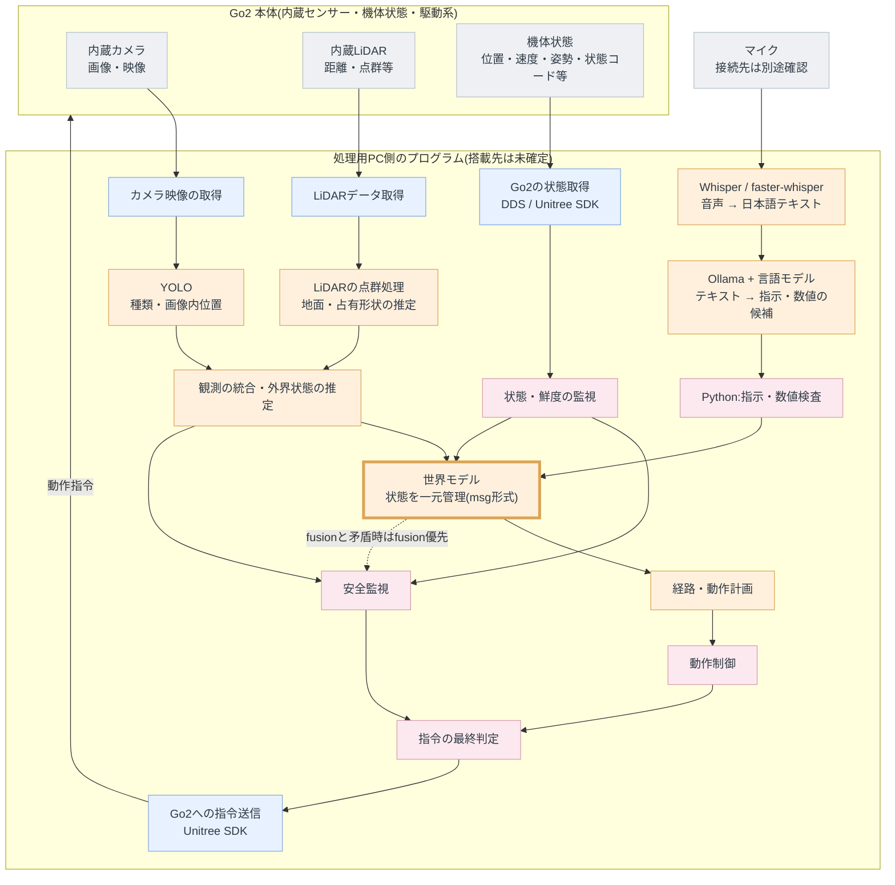

# Go2 音声指示・自律移動システム 構成図

このファイルは、システム構成図(画像)をテキスト化したものです。
ノード ID(英字)はコード上のモジュール名・ROS 2 ノード名の候補として使ってください。
図と実装が食い違う場合は、勝手に図を変えず、差分を報告してください。

## 1. 全体フロー(Mermaid)

## 2. 枠色(カテゴリ)の意味

枠色は「今後の変更の種類」を表す。矢印の色とは無関係。

| カテゴリ | 図の枠色 | 意味 |
|---|---|---|
| feature | オレンジ | 機能追加の主な変更候補 |
| iface | 青 | 接続・データ形式 |
| safety | ピンク | 安全・制御の再評価 |
| device | グレー | 機器・取得元 |

`world_model` は今回追加したノード(図では太枠で強調)。

## 3. ノード一覧

| ID | 名前 | 場所 | カテゴリ | 役割・メモ |
|---|---|---|---|---|
| go2_camera | 内蔵カメラ | Go2 | device | 画像・映像。Go2から取得 |
| go2_lidar | 内蔵LiDAR | Go2 | device | 距離・点群等。Go2から取得 |
| go2_state | 機体状態 | Go2 | device | 位置・速度・姿勢、状態コード等 |
| mic | マイク | 外部 | device | 音声を取得。接続先は別途確認。Go2内蔵マイクの使用は未指定 |
| whisper | Whisper / faster-whisper | PC | feature | 音声 → 日本語テキスト。既存:base モデル |
| camera_ingest | カメラ映像の取得 | PC | iface | 受信・復号・時刻付与。取得API・方式は確認 |
| lidar_ingest | LiDARデータ取得 | PC | iface | 受信・整形・時刻付与。対応ドライバーを確認 |
| go2_state_ingest | Go2の状態取得 | PC | iface | DDS / Unitree SDK。既存コードに受信処理あり |
| llm | Ollama + 言語モデル | PC | feature | テキスト → 指示・数値の候補。既定モデル:qwen2.5:3b |
| yolo | YOLO | PC | feature | 物体の種類・画像内位置。領域分割は別途評価 |
| pointcloud | LiDARの点群処理 | PC | feature | 地面・占有形状の推定。方式・評価は未確定 |
| state_monitor | 状態・鮮度の監視 | PC | safety | 位置・速度・姿勢を監視。受信断・異常を確認 |
| command_validator | Python:指示・数値検査 | PC | safety | 補完・算出・全計画の検査。AIの回答を直接実行しない |
| fusion | 観測の統合・外界状態の推定 | PC | feature | カメラとLiDARの時刻・座標を整合。障害物・通行候補・本人位置・誤差を保持 |
| world_model | 世界モデル | PC | feature(新規) | 速度・角速度・位置・加速度・外界の状態を一元管理。機体状態は `state_monitor` から受け取る。msg形式で管理し、一部をLLM向けに抜粋 |
| planner | 経路・動作計画 | PC | feature | 指示 + 外界状態 → 人とGo2が通れる計画。LLMで行動・経路候補を提案する構成も検討。通行可否は別途検査 |
| safety_monitor | 安全監視 | PC | safety | 動的基準にLLM候補を使う。固定の安全上限は維持。停止はLLMと独立。`fusion` と `world_model` の外界状態が食い違う場合は `fusion` を優先(暫定) |
| motion_control | 動作制御 | PC | safety | 速度・加減速・停止確認。要件ID:F09 |
| final_gate | 指令の最終判定 | PC | safety | 許可と指令の期限を確認。要件ID:F01・F16。送信担当は1つ |
| command_sender | Go2への指令送信 | PC | iface | Unitree SDK。許可された移動・停止・姿勢の要求を、上部と同じGo2本体へ送り返す |

要件ID(F01・F09・F16)の定義はこの図には記載されていない。別資料を参照すること。

## 4. エッジ一覧(データの流れ)

| From | To | 内容 |
|---|---|---|
| mic | whisper | 音声 |
| go2_camera | camera_ingest | 画像・映像 |
| go2_lidar | lidar_ingest | 点群 |
| go2_state | go2_state_ingest | 機体状態 |
| whisper | llm | 日本語テキスト |
| camera_ingest | yolo | 時刻付き画像 |
| lidar_ingest | pointcloud | 時刻付き点群 |
| go2_state_ingest | state_monitor | 機体状態 |
| llm | command_validator | 指示・数値の候補 |
| yolo | fusion | 検出結果 |
| pointcloud | fusion | 地面・占有形状 |
| command_validator | world_model | 検査済みの指示 |
| fusion | world_model | 外界状態(障害物・通行候補・本人位置・誤差) |
| fusion | safety_monitor | 外界状態 |
| state_monitor | safety_monitor | 機体状態と鮮度・異常 |
| state_monitor | world_model | 鮮度確認済みの機体状態(速度・角速度・位置・加速度・姿勢) |
| world_model | planner | 指示と状態 |
| world_model | safety_monitor | 状態(外界状態は fusion と矛盾したら fusion を優先) |
| planner | motion_control | 計画 |
| motion_control | final_gate | 動作指令の候補 |
| safety_monitor | final_gate | 許可・停止判断 |
| final_gate | command_sender | 許可された指令 |
| command_sender | go2(本体) | 動作指令 |

## 5. 守るべき設計上の制約

図の記述から読み取れる不変条件。実装・変更時はこれを破らないこと。

1. LLM(`llm`)の出力は、必ず `command_validator` を通してから使う。AIの回答を直接実行する経路を作らない。
2. Go2 への送信は `command_sender` の1か所だけが行う。そこへ到達する指令は必ず `final_gate` を通る。
3. `final_gate` は許可と指令の期限を確認し、期限切れの指令は送らない。
4. `safety_monitor` の停止判断はLLMから独立させる。LLM候補は動的基準として使ってよいが、固定の安全上限は常に維持する。
5. 通行可否は、`planner` が LLM 候補を使う場合でも別途検査する。
6. `world_model` は msg 形式を正本とし、LLM に渡すのはその一部を抜粋したものだけにする。
7. `world_model` は機体状態を `go2_state_ingest` から直接読まず、鮮度・異常を確認済みの `state_monitor` 経由で受け取る。
8. `safety_monitor` は、`fusion` と `world_model` の外界状態が食い違った場合は `fusion` を優先する(暫定方針。見直す場合はこの項目を更新する)。

## 6. 未確定事項・要確認点

図中で「確認」「未確定」とされているもの:

- マイクの接続先、Go2内蔵マイクを使うかどうか
- 処理用PC側プログラムの搭載先
- カメラ映像の取得API・方式、LiDARの対応ドライバー
- YOLOの領域分割の採否、点群処理の方式・評価

暫定で決めたもの(後で見直す可能性あり):

- `safety_monitor` で `fusion` と `world_model` が食い違ったときは `fusion` を優先する(5章の8)。
